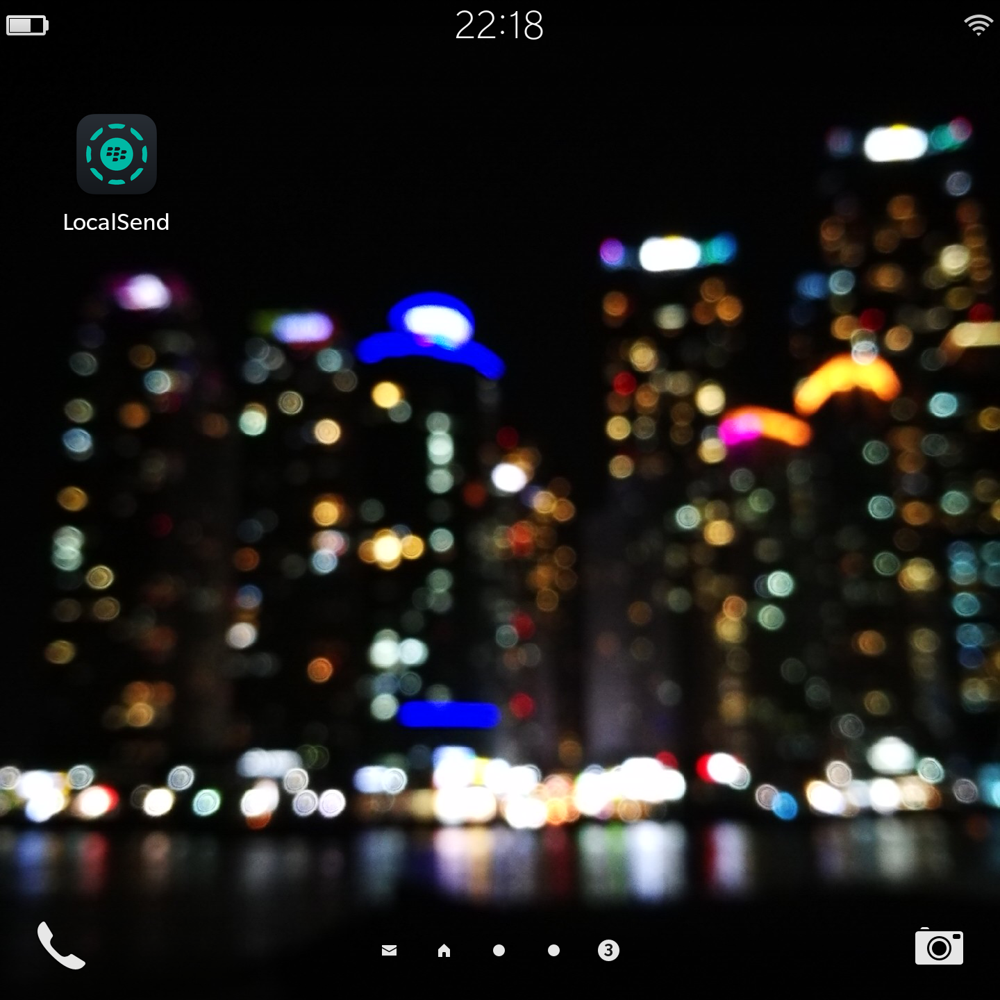
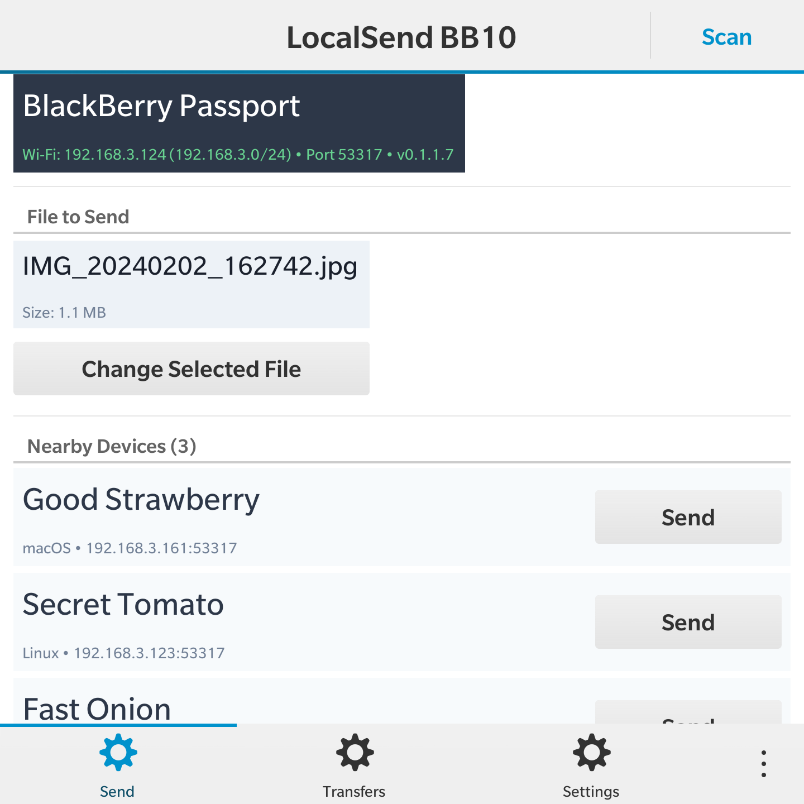
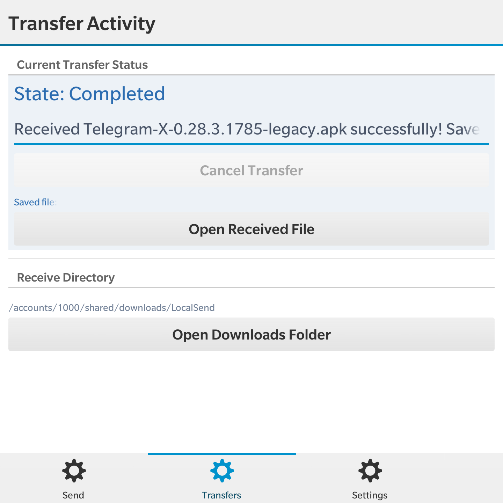
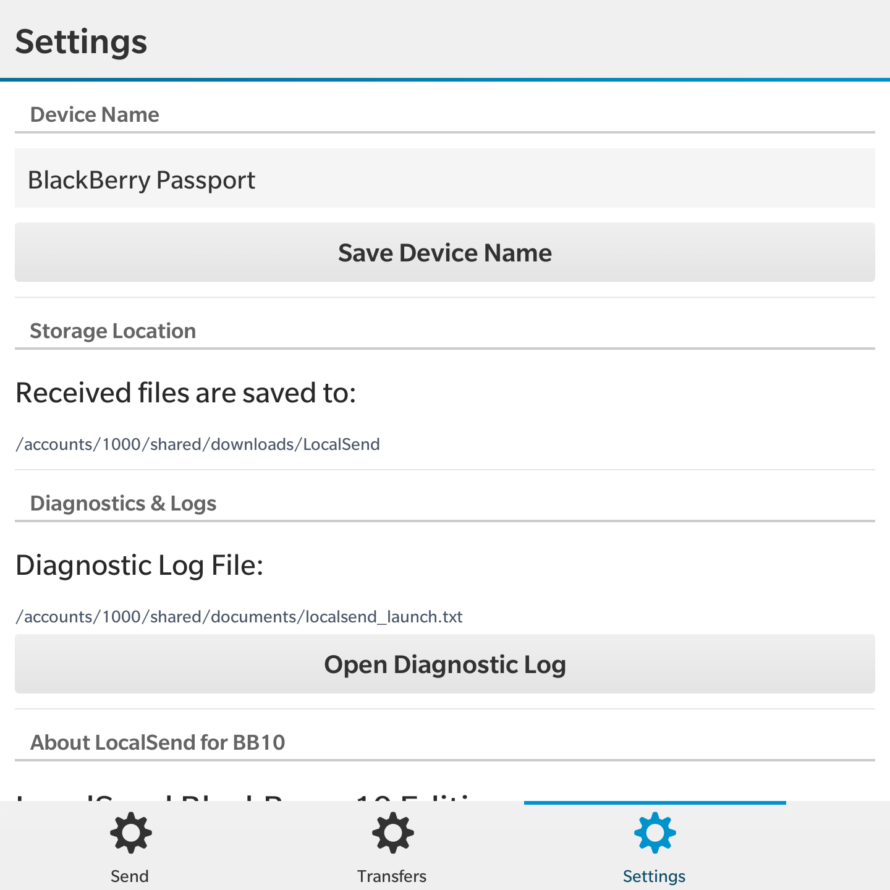

# LocalSend for BlackBerry 10

An unofficial, native client bringing modern **[LocalSend](https://github.com/localsend/localsend)** local network file sharing to legacy **BlackBerry 10** devices (BlackBerry Passport, Classic, Q10, Z30, etc.).

This project is built purely out of passion for retro hardware preservation—giving beloved legacy devices a second life as practical, seamless tools in modern local networks.

> [!NOTE]
> This project is an independent community effort and is **not** officially affiliated with or endorsed by the upstream LocalSend team. It implements the open [LocalSend Protocol v2](https://github.com/localsend/protocol).

---

## Features

- **Native BlackBerry 10 Experience**: Built specifically for BB10 with a fluid, responsive layout that fits square and portrait screens alike, supporting both dark and light system themes.
- **Local Network Discovery**:
  - Automatic detection of nearby devices via multicast (`224.0.0.167`) and broadcast UDP.
  - Active subnet scanning with paced unicast fallback to bypass Wi-Fi AP client isolation.
  - Device cards displaying alias, device model, and real-time status.
- **Seamless Bidirectional Transfers**:
  - **PC / Phone -> BlackBerry 10**: Instant transfer acceptance alert on the Radar tab or Transfers tab with one-tap confirmation.
  - **BlackBerry 10 -> PC / Phone**: Native system file picker to select and send photos, documents, and media.
  - Streaming SHA-256 validation ensuring bit-exact transfer integrity.
- **Settings & Diagnostics**:
  - Customizable device alias and network port.
  - In-app diagnostic log viewer accessible via the built-in Docs To Go viewer.

---

## Screenshots

| Home Screen Icon | Nearby Peers Radar | Transfer Activity | Settings & Diagnostics |
| :---: | :---: | :---: | :---: |
|  |  |  |  |

---

## Prerequisites & Installation

### 1. Root Access
Due to the shutdown of official BlackBerry infrastructure in 2022, installing unsigned native applications on BlackBerry 10 requires the device to be rooted.
- If your device is not yet rooted, please look into community root solutions (such as custom patched autoloader toolchains).
- **Safety note**: Trusted community autoloaders are built locally by unpacking official BlackBerry signed firmware and applying minimal system patches, keeping the underlying OS clean and verifiable.

### 2. Installing the App (`.bar`)
You can install the pre-built `localsend-bb10.bar` package using any standard BlackBerry 10 app installer or management tool:
- **Graphical Tools**: DBBTool, Sachesi, Chrome BB10 / PlayBook App Manager extension, or similar community sideloading utilities.
- **Command Line**: Use `blackberry-deploy` if you have the BlackBerry WebWorks / NDK tools installed:
  ```sh
  blackberry-deploy -installApp -device <DEVICE_IP> -password <DEVICE_PASSWORD> localsend-bb10.bar
  ```

---

## Interoperability with Official LocalSend Clients

To share files between your BlackBerry 10 device and modern clients (Windows, macOS, Linux, Android, iOS):
1. Connect both devices to the same local Wi-Fi network.
2. In the official LocalSend client on your PC or smartphone, navigate to **Settings** and turn off **Encryption (HTTPS)** (switch to standard HTTP mode).
   > *Why HTTP?* Legacy BB10 systems only support older SSL/TLS cipher suites (OpenSSL 1.0.x / 0.9.8) and lack modern TLS 1.3 / contemporary cipher support required by modern HTTPS endpoints. Plain HTTP operates transparently and reliably across your local private network.
3. Your BlackBerry device will automatically appear in the nearby devices radar—ready to send and receive!

---

## Building from Source

To build and package the native application from source using Docker and the BlackBerry 10 NDK, refer to [docs/build-deploy.md](docs/build-deploy.md).

---

## License

This project is licensed under the [MIT License](LICENSE).
