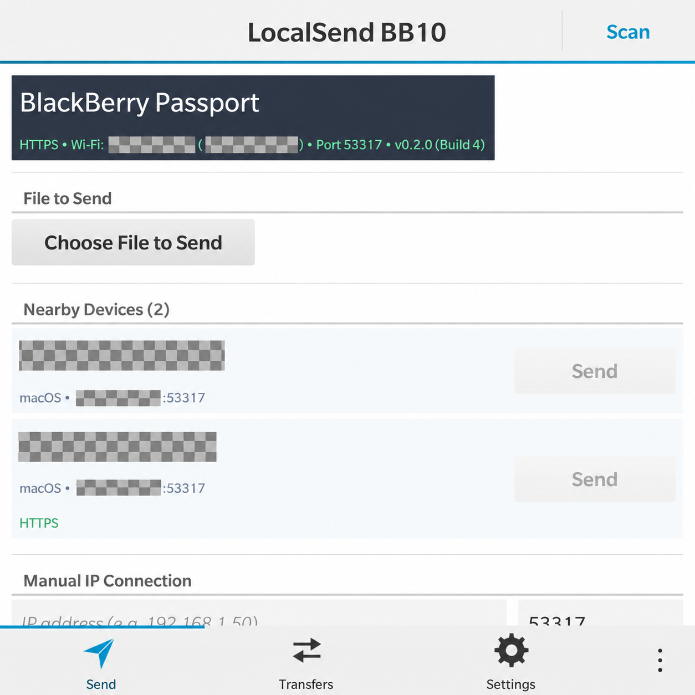

# LocalSend for BlackBerry 10

An unofficial, native LocalSend client for BlackBerry 10, built with C++03, Qt 4.8.5, and Cascades. It supports LocalSend protocol v2.2 over an IPv4 local network, with HTTPS peer certificate fingerprint verification and compatible HTTP connections.

This project is built purely out of passion for retro hardware preservation—giving beloved legacy devices a second life as practical, seamless tools in modern local networks.

> [!NOTE]
> This project is an independent community effort and is **not** officially affiliated with or endorsed by the upstream LocalSend team. It implements the open [LocalSend Protocol v2.2](https://github.com/localsend/protocol).

---

## Current release

**0.2.0 (Build 4)** · [GitHub Releases and downloads](https://github.com/ItsLaurelNotYanny/localsend-bb10/releases)

The release package is `localsend-bb10-v0.2.0-build4.bar`. Install it on a compatible BlackBerry 10 device using the steps in [Prerequisites & Installation](#prerequisites--installation) and [Build and Deploy](docs/build-deploy.md).

---

## Features

- **Native BlackBerry 10 Experience**: Native Cascades interface with a fully adapted square-screen layout verified on BlackBerry Passport. Portrait-screen devices have not been tested.
- **Local Network Discovery**:
  * Automatic detection of nearby devices via multicast (`224.0.0.167`) and broadcast UDP.
  * Active subnet scanning with paced unicast fallback, plus manual connection by IP address and port. The network must allow communication between devices; scanning does not bypass AP client isolation.
  * Device cards displaying alias, device model, network address, and HTTPS status.
- **Seamless Bidirectional Transfers**:
  * **PC / Phone -> BlackBerry 10**: Instant transfer acceptance alert on the Send (Radar) tab or Transfers tab with one-tap confirmation.
  * **BlackBerry 10 -> PC / Phone**: Native system file picker to select and send photos, documents, and media.
  * **HTTPS with peer certificate fingerprint verification**; peers with encryption turned off are reached over plain HTTP.
  * Shows a SHA-256 verified status when a supplied file checksum matches.
- **Settings & Diagnostics**:
  * Customizable device alias and manual peer connection by IP address and port.
  * Open diagnostic logs using the device’s associated text viewer.

---

## Screenshots

| Home Screen Icon | Nearby Peers (Privacy-Redacted) | Transfer Activity | Settings & Diagnostics |
| --- | --- | --- | --- |
|  |  |  |  |

Network addresses and peer aliases in the discovery screenshot have been redacted for privacy.

---

## Compatibility and scope

The application targets BlackBerry 10 OS 10.3.x, ARMv7, and Qt 4.8.5. Version 0.2.0 (Build 4) was verified on a BlackBerry Passport running OS 10.3.3.3216, including 10 MiB transfers in both directions. The square-screen Passport layout has been verified. Other BlackBerry 10 devices, including portrait-screen models, have not been tested.

The app is designed for foreground use on an IPv4 local network. It handles ordinary single-file transfers. Directory transfer, resumable transfer, background service operation, PIN-protected transfers, and the LocalSend Download API are outside the current scope.

Local network discovery and transfers require the device and peer to be able to communicate on the same LAN.

---

## Prerequisites & Installation

### 1. Root Access

Due to the shutdown of official BlackBerry infrastructure in 2022, installing unsigned native applications on BlackBerry 10 requires the device to be rooted.

- If your device is not yet rooted, please look into community root solutions (such as custom patched autoloader toolchains).
- Follow the documentation for your device’s community root solution before proceeding with installation.

### 2. Installing the App (`.bar`)

You can install the pre-built `localsend-bb10-v0.2.0-build4.bar` package using a compatible BlackBerry 10 sideloading tool:

- **Graphical Tools**: DBBTool, Sachesi, Chrome BB10 / PlayBook App Manager extension, or similar community sideloading utilities.
- **Command Line**: Enable **Development Mode** under Settings → Security and Privacy on the rooted device, note its IP address and device password, and use `blackberry-deploy` from the BlackBerry WebWorks / NDK tools:

```bash
blackberry-deploy -installApp -device <DEVICE_IP> -password <DEVICE_PASSWORD> -package localsend-bb10-v0.2.0-build4.bar
```

---

## Interoperability with Official LocalSend Clients

To share files between your BlackBerry 10 device and modern clients (Windows, macOS, Linux, Android, iOS):

1. Connect both devices to the same local Wi-Fi network.
2. **Encryption (HTTPS)** can remain enabled. Both HTTPS and compatible plain-HTTP peers are supported.
3. Disable the receiving peer’s PIN requirement: PIN-protected transfers are not supported in this release.
4. Allow LocalSend through the peer’s firewall. If discovery does not find the peer, tap **Scan** or use **Manual IP Connection** with its IP address and port (normally `53317`). Guest networks and AP client isolation may prevent communication.
5. Choose one file on the Send tab and tap **Send** on the peer card. Accept incoming offers on the Send or Transfers tab. Keep the app in the foreground during transfers.

LocalSend uses self-signed peer certificates. For HTTPS peers, this app compares the certificate's SHA-256 fingerprint with the fingerprint the peer announced, and uses that to identify the peer connection.

Received files are saved to `shared/downloads/LocalSend` on the device. The Transfers tab provides **Open Received File** and **Open Downloads Folder** actions.

---

## Development

To build and package the native application from source using Docker and the BlackBerry 10 NDK, refer to [docs/build-deploy.md](docs/build-deploy.md).

---

## License

This project is licensed under the [MIT License](LICENSE).
